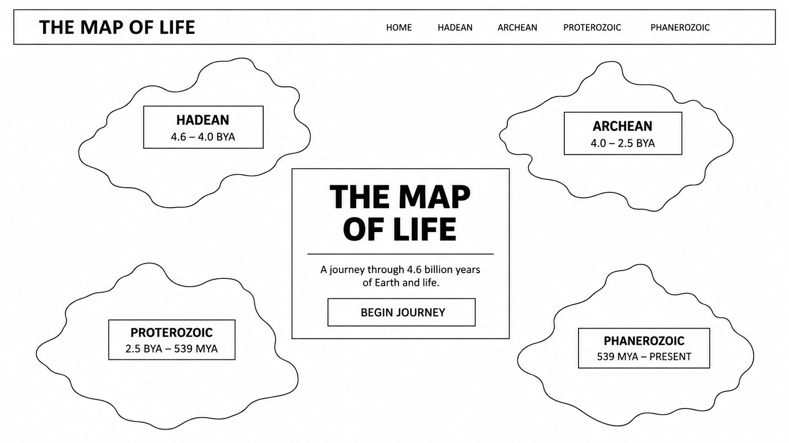
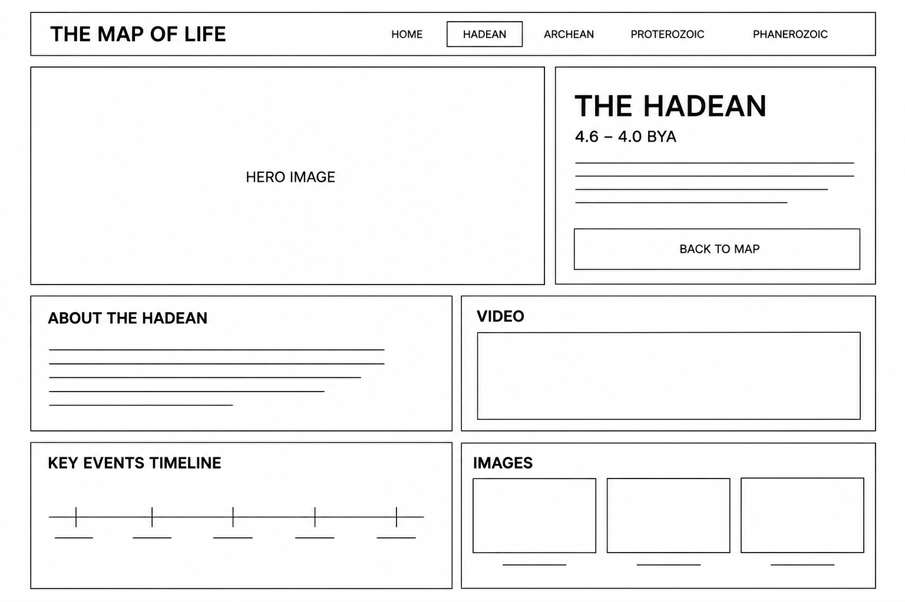

# The Map of Life

The Map of Life is my midterm project for Introduction to Web Development. It
uses a pixel-art map to introduce four major eons in Earth's history. Each
island leads to a page with a short overview, timeline, facts, sources, and a
video.

## Live site

[View the project on GitHub Pages](https://yl14154-sudo.github.io/web_dev_homework/Midterm/)

## Site map

```text
Map / Home
├── Hadean
├── Archean
├── Proterozoic
├── Phanerozoic
└── Contact
```

The final home page follows my original idea of using four islands as the main
navigation. I simplified some of the interactions so I could focus on making
the information clear and keeping all five pages responsive.

## Original wireframe

### Home page



### Detail page



The full Week 04 proposal is also preserved in the repository at
[`week04/midterm proposal.md`](../week04/midterm%20proposal.md).

## Week 09 work

- Added a contact form.
- Moved repeated colors into CSS variables.
- Fixed the long detail-page headings so they stay inside their cards.
- Adjusted the timeline, navigation, and text for smaller screens.
- Checked the page links, image paths, and alt text.
- Resized images that were much larger than their display size.

## Image optimization

The `assets` folder was about **16 MB** before optimization and is about **10
MB** after resizing. I kept the map and hero images large enough for wide
screens, but reduced the timeline images because they display as small
thumbnails.

## Credits

Built by Yiyan Luo for Introduction to Web Development. Scientific references
are linked in the source trail on each geological detail page.
