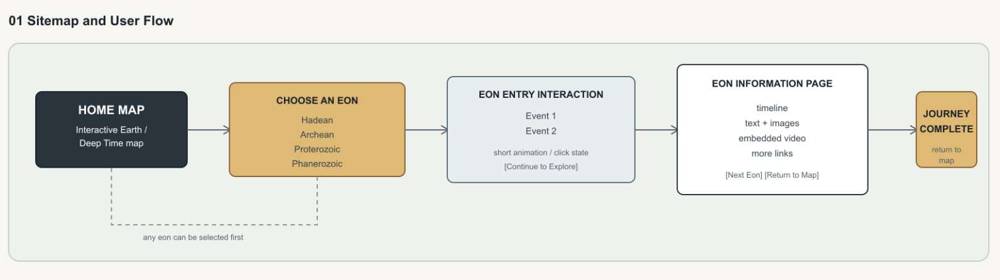

# The Map of Life

## Concept

### An interactive journey through 4.6 billion years of Earth and life.

My website will explore the history of Earth through its four major geological eons:

- **Hadean** — ~4.6–4.0 billion years ago
- **Archean** — ~4.0–2.5 billion years ago
- **Proterozoic** — ~2.5 billion–539 million years ago
- **Phanerozoic** — ~539 million years ago–present

Instead of creating a traditional textbook-style timeline, I want to turn Earth's history into an **interactive map**.

The homepage will show the four eons as four different regions on a map. Users can choose any region and enter that period of Earth's history.

Each eon will begin with **one or two main interactive experiences** based on the most important event or transformation of that period. After the interaction, users can explore a timeline and learn more about the geological and biological events that happened during that time.

The experience will eventually lead to the present day, where the journey ends and the user returns to the map.

---

## Existing Website Inspiration

### Deep Time Explorer

https://deeptimeexplorer.earth/

I was inspired by the way Deep Time Explorer presents Earth's history as something that users can explore rather than simply read.

I want to take inspiration from its timeline and educational approach, but create a different experience where the **homepage itself is an interactive map** and each geological eon has its own interaction.

---

# Concepts & Skills We Have Covered

## HTML

- Semantic HTML
- Links
- Images
- Embedded media

## CSS

- Flexbox
- Positioning
- Typography
- Color
- Background images
- Borders
- Responsive layout

---

# Concepts & Skills I Still Need to Learn

- More advanced CSS animations
- Creating interactive visual effects with CSS
- Possibly basic JavaScript for interactions that cannot be achieved with CSS alone

---

# Sitemap



```text
THE MAP OF LIFE
│
├── HOME / INTERACTIVE MAP
│   │
│   ├── Hadean
│   │   ├── Interactive Experience
│   │   ├── Timeline
│   │   ├── Educational Content
│   │   ├── Images
│   │   ├── Videos
│   │   └── Learn More
│   │
│   ├── Archean
│   │   ├── Interactive Experience
│   │   ├── Timeline
│   │   ├── Educational Content
│   │   ├── Images
│   │   ├── Videos
│   │   └── Learn More
│   │
│   ├── Proterozoic
│   │   ├── Interactive Experience
│   │   ├── Timeline
│   │   ├── Educational Content
│   │   ├── Images
│   │   ├── Videos
│   │   └── Learn More
│   │
│   └── Phanerozoic
│       ├── Interactive Experience
│       ├── Timeline
│       │   ├── Paleozoic
│       │   ├── Mesozoic
│       │   └── Cenozoic
│       ├── Educational Content
│       ├── Images
│       ├── Videos
│       └── Learn More
│
└── PRESENT DAY
    │
    ├── Journey Complete
    └── Return to Map
