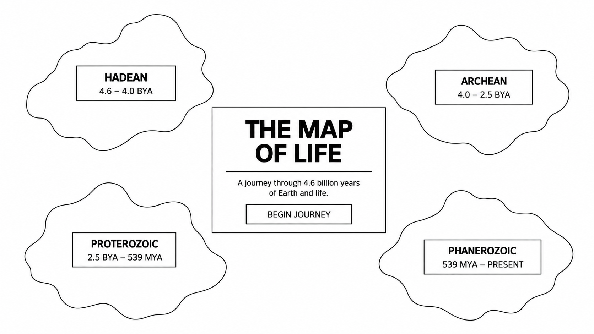
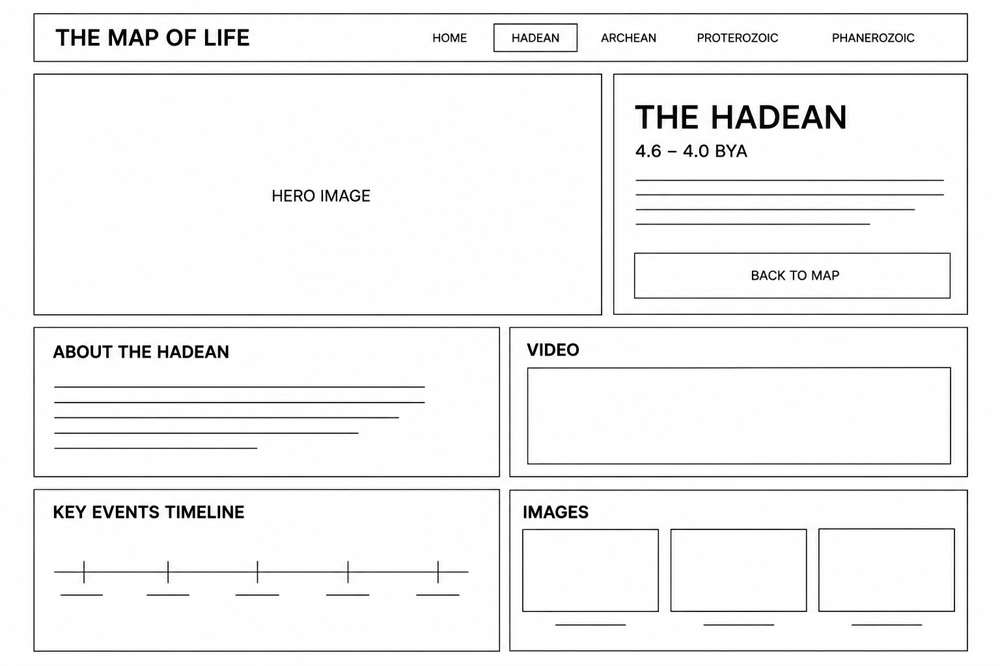

# The Map of Life

## 1. Concept / Theme

**The Map of Life** is an educational website about the history of Earth and the development of life over approximately 4.6 billion years.

The homepage will be designed as an illustrated map with four different island-like regions, representing the four major geological eons:

- **Hadean** — approximately 4.6–4.0 billion years ago
- **Archean** — approximately 4.0–2.5 billion years ago
- **Proterozoic** — approximately 2.5 billion–539 million years ago
- **Phanerozoic** — approximately 539 million years ago–present

Each region will have its own visual style based on the environment and life of that period.

Users can select a region from the map and go to a page about that geological eon. Each page will contain educational information, images, a video, and a simple timeline showing important events from that period.

The goal is to make Earth's history feel like a journey through different places rather than a traditional textbook.

### Target Audience

The website is designed for:

- Students learning about Earth science
- People interested in dinosaurs, evolution, and natural history
- Visitors who want a simple visual introduction to Earth's history

---

## 2. Website Inspiration

### Deep Time Explorer

[Deep Time Explorer](https://deeptimeexplorer.earth/)

I was inspired by the way Deep Time Explorer presents Earth's history as something that users can explore visually instead of only reading about it.

I want to take inspiration from its educational approach and its presentation of geological time.

However, my website will have a different visual structure.

Instead of starting with a traditional timeline, my homepage will be an illustrated map with four island-like regions. Each region represents a different geological eon.

I also want the individual eon pages to combine:

- Large visual images
- Educational text
- Videos
- A simple timeline

I want the design to feel more like exploring a world than reading a textbook.

---

## 3. What I Can Already Build

Based on the HTML and CSS concepts we have learned during the last three weeks, I can already build many of the main parts of this website.

### HTML

- Semantic HTML
- Headings and paragraphs
- Links
- Images
- Embedded videos
- Navigation

### CSS

- Box model
- Flexbox
- Positioning
- Typography
- Colors
- Background images
- Borders
- Basic responsive layouts

I can use these skills to create the main map layout, navigation, hero sections, image sections, and information sections.

For example, I can use **positioning** to place the names of the four geological eons over different areas of the homepage map.

I can use **Flexbox** to arrange the images and information on each eon page.

---

## 4. What I Still Need to Learn

The main things I still need to learn are:

- More advanced responsive design
- Media queries
- Better techniques for creating illustrated layouts
- How to create a map-like homepage using HTML and CSS
- How to organize a larger website with multiple pages
- How to embed and style videos effectively
- Possibly some basic JavaScript if I need it later

I am intentionally keeping the project focused on layout, visuals, images, video, and information rather than complicated interactive effects.

If I discover that some part of the map or layout is difficult to build, I can ask for help and learn the necessary technique during the project.

---

## 5. Sitemap





```text
                         THE MAP OF LIFE
                                │
                                │
                              HOME
                         Illustrated Map
                                │
              ┌─────────────────┼─────────────────┐
              │                 │                 │
           HADEAN            ARCHEAN         PROTEROZOIC
              │                 │                 │
              │                 │                 │
        Eon Information   Eon Information   Eon Information
              │                 │                 │
        ┌─────┼─────┐     ┌─────┼─────┐     ┌─────┼─────┐
        │     │     │     │     │     │     │     │     │
      Video Images Timeline Video Images Timeline Video Images Timeline


                                │
                                │
                          PHANEROZOIC
                                │
                    ┌───────────┼───────────┐
                    │           │           │
                 Paleozoic   Mesozoic   Cenozoic
                    │           │           │
                 Timeline    Timeline    Timeline

